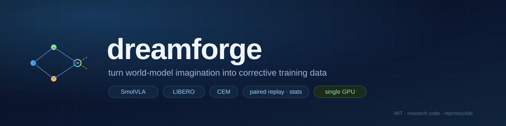
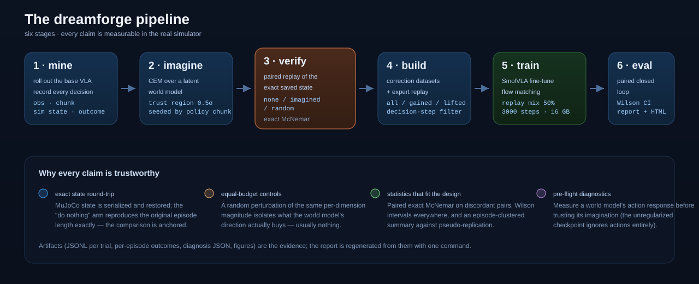
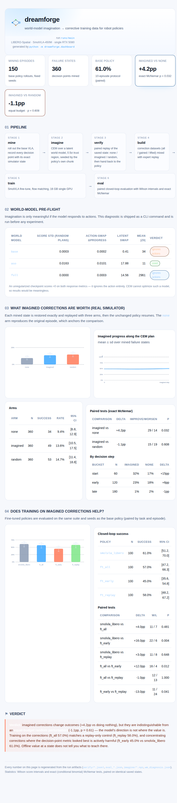

<div align="center">



# dreamforge

**Turn world-model imagination into corrective training data for robot policies.**

A single-GPU, end-to-end research pipeline with a **falsifiable** core:
every imagined action is replayed in the real simulator before anything is
claimed about it.

[](LICENSE)


[](https://github.com/rzc156/dreamforge/actions/workflows/ci.yml)

[English](README.md) · [中文](README_zh.md) · [Protocol](docs/protocol.md) · [Results](docs/results.md) · [Dashboard](results/dashboard.html)

</div>

---

## Why this exists

A previous controlled study found that **test-time action selection** — sampling
several candidate chunks from a flow-matching VLA and picking the one a world
model likes best — has **near-zero headroom** on a strong policy, and that
offline world-model scores do not predict decision quality.

That leaves the obvious question:

> If imagination cannot **select**, can it **teach**?

`dreamforge` answers it end to end: mine the policy's own failure states, use a
latent world model to search *corrective* action chunks (CEM), **verify each
correction by replaying the exact simulator state**, and only then decide
whether it is worth training on.

<p align="center">
  
</p>

## Headline results

LIBERO-Spatial · SmolVLA-450M · 150 mined episodes → **360 failure states** ·
**1080+ paired simulator replays** · single RTX 5080. Full log:
[`docs/results.md`](docs/results.md).

| experiment | result |
|---|---|
| world-model pre-flight ([`diagnose`](src/dreamforge/diagnose.py)) | unregularized WM action response **0.0003** vs action-sensitive **0.0163** (~50×) |
| imagined progress (CEM) | 0.480 → 0.500 (+0.020) |
| **real value of corrections**, 360 paired states | none **9.4%** · imagined **13.6%** · random **14.7%** |
| **imagined vs none** | **+4.2pp, exact McNemar p = 0.032** |
| **imagined vs equal-budget random** | **−1.1pp, p = 0.61** — the model's direction buys nothing |
| training on corrections (`ft_all`) | 57.0% vs base 61.0% vs replay-only control 58.0% (**p = 1.0**) |
| corrections concentrated where the metric looked best (`ft_early`) | **45.0%** — 13pp *worse* than the control (p = 0.041) |

<details>
<summary><b>What that means (click)</b></summary>

World-model imagination changes outcomes, but **only as much as a random
perturbation of the same magnitude**, and training on it does not beat a
replay-only control. Worse, feeding corrections where the decision-point metric
says they help most *hurts*: those states are not reliably failures (the policy
succeeds from the same initial state most of the time), so imitating a
perturbation there overwrites correct behaviour.

The practical reading, and the reason the tooling is the point of this repo:
**before paying for a world model in a control loop, (1) measure its action
response, (2) benchmark its output against an equal-budget random perturbation,
(3) never assume a decision-point metric is a training signal.**

</details>

## Interactive dashboard

Every run renders a **self-contained HTML dashboard** (no CDN, no JavaScript)
from its artifacts — handy for a report, a PR, or GitHub Pages.

<p align="center">
  
</p>

```bash
python -m dreamforge.dashboard --run runs/main --out results/dashboard.html
```

The committed copy lives at [`results/dashboard.html`](results/dashboard.html).

## Quickstart

```bash
pip install -e . --no-deps     # library only needs numpy + torch
pytest tests -q                # 10 tests, CPU only

RUN=runs/main
python -m dreamforge.mine     --task libero_spatial --episodes 15 --out $RUN/mine
python -m dreamforge.diagnose --mine $RUN/mine --wms base aso --out $RUN/wm_diagnosis.json
python -m dreamforge.imagine  --mine $RUN/mine --out $RUN/imagine --wm aso --delta-sigma 0.5
python -m dreamforge.verify   --mine $RUN/mine --imagine $RUN/imagine --out $RUN/verify \
                              --arms none imagined random --exec-horizon 16
python -m dreamforge.build    --mine $RUN/mine --imagine $RUN/imagine --out $RUN/build_all --filter all
python -m dreamforge.train    --samples $RUN/build_all --out $RUN/ft_all --steps 3000
python -m dreamforge.eval     --policy-path $RUN/ft_all --task libero_spatial --episodes 10 \
                              --out $RUN/eval_ft_all.json
python -m dreamforge.report   --run $RUN            # markdown + figures
python -m dreamforge.dashboard --run $RUN           # HTML dashboard
```

`make mine imagine verify build train eval report` runs the same stages.

## CLI

| command | what it does |
|---|---|
| `mine` | roll out the base policy, record every decision point (obs, chunk, **exact sim state**, outcome) |
| `imagine` | CEM over the latent world model; 0.5σ per-dimension trust region seeded by the policy's chunk |
| `verify` | **paired replay** of each saved state: `none` / `imagined` / `random`, then hand back to the policy |
| `build` | correction datasets — `all` / `gained` (WM score) / `lifted` (sim-verified), plus a decision-step filter |
| `train` | SmolVLA fine-tune (flow matching) on corrections mixed with expert replay |
| `eval` | paired closed-loop evaluation (Wilson intervals, exact McNemar) |
| `report` / `dashboard` | markdown report + self-contained HTML dashboard |
| `diagnose` | world-model pre-flight: does the model respond to actions at all? |
| `figures` | publication-style figures for a run |

## Repository layout

```text
src/dreamforge/
  wm.py         latent world model + progress head
  cem.py        CEM planner (trust region, dataset-space actions)
  envs.py       LIBERO env helpers — exact MuJoCo state save/restore
  policy.py     SmolVLA loading and observation/action pipelines
  mining.py     stage 1  ·  imagine.py  stage 2  ·  verify.py  stage 3
  dataset.py    stage 4  ·  finetune.py stage 5  ·  evaluate.py stage 6
  report.py     paired statistics   ·  dashboard.py  HTML interface
  figures.py    plots               ·  diagnose.py   WM pre-flight
  stats.py      Wilson / exact McNemar
assets/         banner, pipeline diagram, dashboard screenshot
docs/           protocol.md · results.md · resume.md
results/        curated artifacts (report, figures, paired records, evals)
scripts/        run_main.sh · run_training.sh · run_ladder.sh · probe_env.py
tests/          statistics · CEM (incl. trust region) · dataset filters
```

## Design principles

1. **Measure before you claim.** Corrections are replayed in the simulator;
   the `none` arm reproduces the original episode, anchoring the comparison.
2. **Control the budget.** Every "model-guided" result is compared against a
   random perturbation of the *same* per-dimension magnitude.
3. **Statistics that fit the design.** Paired exact McNemar, Wilson intervals,
   and an episode-clustered summary against pseudo-replication.
4. **Fail loudly on silent bugs.** Three real pipeline bugs were found and
   fixed by this discipline: OOD actions from an unconstrained CEM (normalized
   targets ×6), double-normalized states, and checkpoints saved without their
   processor pipeline.

## Roadmap

- [ ] Replicate the targeted-training drop across training seeds
- [ ] Unconstrained-budget sweep (large random perturbations hurt; does a large
      *model-guided* deviation help? — the open mechanism question)
- [ ] A second suite / base policy, and a video world model
- [ ] `verify` in parallel workers (trials are CPU-bound)

## Citation & attribution

The latent world model, the CEM interface and the evaluation protocol adapt
code from the author's previous research project (`near-zero-headroom`,
manuscript under review), reused with permission. If you use this repository,
please cite it via [`CITATION.cff`](CITATION.cff).

## License

MIT — see [LICENSE](LICENSE).
