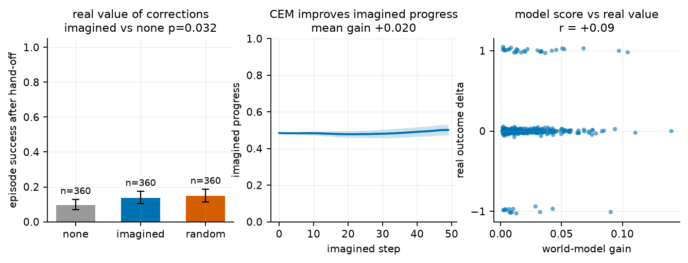
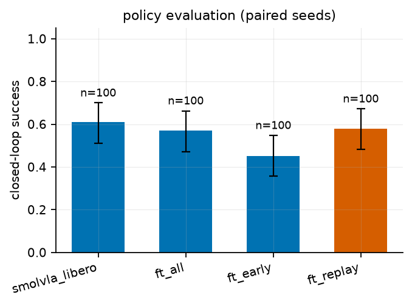

# dreamforge run report

## Imagined corrections (world-model side)

- world model: `aso`  context: `failure`
- states imagined: **360**  (0.19 min)

| episode file | states | WM score init -> best |
|---|---|---|
| libero_spatial__task00__ep002.npz | 6 | 0.476 -> 0.493 |
| libero_spatial__task00__ep006.npz | 6 | 0.480 -> 0.501 |
| libero_spatial__task00__ep008.npz | 6 | 0.477 -> 0.487 |
| libero_spatial__task00__ep010.npz | 6 | 0.484 -> 0.504 |
| libero_spatial__task00__ep012.npz | 6 | 0.472 -> 0.485 |
| libero_spatial__task01__ep000.npz | 6 | 0.479 -> 0.514 |
| libero_spatial__task01__ep001.npz | 6 | 0.477 -> 0.489 |
| libero_spatial__task01__ep007.npz | 6 | 0.482 -> 0.502 |
| libero_spatial__task01__ep008.npz | 6 | 0.484 -> 0.498 |
| libero_spatial__task01__ep009.npz | 6 | 0.480 -> 0.500 |
| libero_spatial__task01__ep010.npz | 6 | 0.492 -> 0.504 |
| libero_spatial__task02__ep003.npz | 6 | 0.479 -> 0.512 |
| libero_spatial__task02__ep005.npz | 6 | 0.470 -> 0.483 |
| libero_spatial__task02__ep006.npz | 6 | 0.482 -> 0.492 |
| libero_spatial__task02__ep011.npz | 6 | 0.480 -> 0.503 |
| libero_spatial__task03__ep005.npz | 6 | 0.483 -> 0.496 |
| libero_spatial__task03__ep007.npz | 6 | 0.489 -> 0.502 |
| libero_spatial__task04__ep001.npz | 6 | 0.464 -> 0.482 |
| libero_spatial__task04__ep002.npz | 6 | 0.481 -> 0.513 |
| libero_spatial__task04__ep003.npz | 6 | 0.472 -> 0.495 |
| libero_spatial__task04__ep008.npz | 6 | 0.481 -> 0.505 |
| libero_spatial__task04__ep010.npz | 6 | 0.476 -> 0.494 |
| libero_spatial__task04__ep013.npz | 6 | 0.472 -> 0.498 |
| libero_spatial__task04__ep014.npz | 6 | 0.484 -> 0.512 |
| libero_spatial__task05__ep000.npz | 6 | 0.495 -> 0.525 |
| libero_spatial__task05__ep001.npz | 6 | 0.467 -> 0.490 |
| libero_spatial__task05__ep002.npz | 6 | 0.470 -> 0.492 |
| libero_spatial__task05__ep003.npz | 6 | 0.481 -> 0.500 |
| libero_spatial__task05__ep004.npz | 6 | 0.488 -> 0.514 |
| libero_spatial__task05__ep005.npz | 6 | 0.489 -> 0.502 |
| libero_spatial__task05__ep006.npz | 6 | 0.474 -> 0.485 |
| libero_spatial__task05__ep007.npz | 6 | 0.491 -> 0.508 |
| libero_spatial__task05__ep008.npz | 6 | 0.486 -> 0.513 |
| libero_spatial__task05__ep009.npz | 6 | 0.482 -> 0.502 |
| libero_spatial__task05__ep010.npz | 6 | 0.475 -> 0.499 |
| libero_spatial__task05__ep011.npz | 6 | 0.476 -> 0.500 |
| libero_spatial__task05__ep012.npz | 6 | 0.464 -> 0.499 |
| libero_spatial__task05__ep013.npz | 6 | 0.473 -> 0.491 |
| libero_spatial__task05__ep014.npz | 6 | 0.484 -> 0.508 |
| libero_spatial__task06__ep005.npz | 6 | 0.480 -> 0.501 |
| libero_spatial__task06__ep014.npz | 6 | 0.488 -> 0.513 |
| libero_spatial__task07__ep000.npz | 6 | 0.491 -> 0.505 |
| libero_spatial__task07__ep004.npz | 6 | 0.475 -> 0.480 |
| libero_spatial__task07__ep009.npz | 6 | 0.472 -> 0.500 |
| libero_spatial__task07__ep010.npz | 6 | 0.484 -> 0.506 |
| libero_spatial__task07__ep013.npz | 6 | 0.466 -> 0.485 |
| libero_spatial__task07__ep014.npz | 6 | 0.491 -> 0.508 |
| libero_spatial__task08__ep001.npz | 6 | 0.493 -> 0.500 |
| libero_spatial__task08__ep002.npz | 6 | 0.485 -> 0.513 |
| libero_spatial__task08__ep004.npz | 6 | 0.504 -> 0.523 |
| libero_spatial__task08__ep005.npz | 6 | 0.479 -> 0.491 |
| libero_spatial__task08__ep006.npz | 6 | 0.473 -> 0.501 |
| libero_spatial__task08__ep007.npz | 6 | 0.480 -> 0.503 |
| libero_spatial__task08__ep010.npz | 6 | 0.484 -> 0.514 |
| libero_spatial__task08__ep011.npz | 6 | 0.485 -> 0.499 |
| libero_spatial__task09__ep001.npz | 6 | 0.477 -> 0.506 |
| libero_spatial__task09__ep004.npz | 6 | 0.493 -> 0.510 |
| libero_spatial__task09__ep010.npz | 6 | 0.491 -> 0.505 |
| libero_spatial__task09__ep012.npz | 6 | 0.477 -> 0.490 |
| libero_spatial__task09__ep013.npz | 6 | 0.477 -> 0.500 |

## Budget comparison (same mined states, different correction budgets)

| verify dir | n | none | imagined | random | imagined-none | imagined-random |
|---|---|---|---|---|---|---|
| verify | 360 | 9.4% | 13.6% | 14.7% | +4.2pp (p=0.032) | -1.1pp (p=0.608) |
| verify_big | 25 | 8.0% | 32.0% | 4.2% | +24.0pp (p=0.070) | +25.0pp (p=0.031) |

_Budgets: `verify` = 0.5σ per-dimension trust region; `verify_big` = unconstrained CEM (dataset-range clipping)._

## Verify: do imagined corrections change outcomes?

| arm | n | success | 95% CI |
|---|---|---|---|
| none | 360 | 34 | 9.4% [6.8, 12.9] |
| imagined | 360 | 49 | 13.6% [10.5, 17.5] |
| random | 360 | 53 | 14.7% [11.4, 18.8] |

- **imagined vs none**: delta = +4.2pp (29 improve / 14 worsen, 360 paired states), exact McNemar p = 0.0315
- **imagined vs random**: delta = -1.1pp (15 improve / 19 worsen, 360 paired states), exact McNemar p = 0.6076

### Episode-clustered view (guard against pseudo-replication)

- episodes with paired states: **60**
- mean per-episode delta (imagined - none): **+4.2pp**
- episodes better / equal / worse: **21 / 30 / 9**

### Does imagined progress predict real value?

- paired states with both arms: **360**
- mean WM gain (best - init): +0.020 (sd 0.021)
- mean real delta (imagined - none): +0.042
- correlation(WM gain, real delta): +0.091
- real delta for high-WM-gain states: +0.078 (n=180), low: +0.006 (n=180)

### By decision step

| bucket | n | imagined | none | delta |
|---|---|---|---|---|
| start | 60 | 32% | 17% | +15pp |
| early | 120 | 23% | 18% | +6pp |
| late | 180 | 1% | 2% | -1pp |

## Policy evaluation (closed loop)

| policy | n | success | 95% CI |
|---|---|---|---|
| smolvla_libero | 100 | 61.0% [51.2, 70.0] |
| ft_all | 100 | 57.0% [47.2, 66.3] |
| ft_early | 100 | 45.0% [35.6, 54.8] |
| ft_replay | 100 | 58.0% [48.2, 67.2] |

- **smolvla_libero vs ft_all**: delta = +4.0pp, 11 win / 7 loss / 18 discordant, exact McNemar p = 0.4807
- **smolvla_libero vs ft_early**: delta = +16.0pp, 22 win / 6 loss / 28 discordant, exact McNemar p = 0.0037
- **smolvla_libero vs ft_replay**: delta = +3.0pp, 11 win / 8 loss / 19 discordant, exact McNemar p = 0.6476
- **ft_all vs ft_early**: delta = +12.0pp, 16 win / 4 loss / 20 discordant, exact McNemar p = 0.0118
- **ft_all vs ft_replay**: delta = -1.0pp, 12 win / 13 loss / 25 discordant, exact McNemar p = 1.0000
- **ft_early vs ft_replay**: delta = -13.0pp, 11 win / 24 loss / 35 discordant, exact McNemar p = 0.0410

